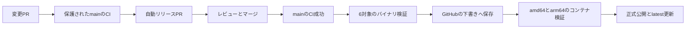

# CI・自動リリース

通常の変更はPRで検証し、mainの成功したCIからRelease Pleaseがバージョン・CHANGELOG・インストール例を更新するリリースPRを自動作成します。
そのPRをレビューしてマージすると、mainのCI成功後に配布処理が自動で進みます。リリースPRの自動承認・自動マージは行いません。
GitHubの仕様により、標準トークンが作ったPRのCIにはメンテナーの実行承認が必要です。差分を確認し、PRの「Approve workflows to run」で承認してください。承認後のPR CIがすべて成功してからマージします。
個人アクセストークンを新しく保存する必要はありません。

## CIで確認すること

- Linux・macOS・WindowsのRustテスト、fmt、Clippy、導入のオフラインスモークテスト。
- Rust 1.88の最低対応版、既定・slimビルド、ネイティブLinux ARM64。
- amd64・arm64のコンテナ起動、バージョン、ヘルス確認。
- 使い捨てMariaDBでのMySQL・MariaDBエンジンの実接続、パラメーターの束縛、ページング。
- Pythonの評価器・リリース・監査ポリシーの回帰テスト、プロバイダー台帳、Markdown、actionlint。
- RustSecの脆弱性と新しい勧告。既知のunsoundness・保守終了は期限付きの一覧に残し、隠して除外しない。

ActionsはコミットSHAで固定し、Dependabotが更新PRを作ります。通常のジョブのトークンは読み取り専用です。
リリースPRのタイトルはConventional Commitsに従ってください。`fix:`、`feat:`、`feat!:`等が次の版と変更履歴に反映されます。
0.xの互換性を壊す変更はMINORを進める設定です。

## 公開前の検証

リリースタグ・Cargo.toml・Cargo.lockの版が一致し、当該コミットがmainの履歴にあり、そのコミットのpush CIが成功したことを要求します。
PRのCI成功、別コミットの成功、取得できなかったCI情報を代用しません。対象ソースのCargo.lockを最新の勧告でもう一度監査するため、過去にCIが成功した旧版でも新たな脆弱性があれば停止します。CHANGELOGに対象版の本文がない場合も停止します。

`.github/release-targets.json`の6対象をビルドし、実行ファイルの形式とCPUを確認します。
Linux・Windows・macOS ARM64では版の確認とローカル偽エンジンによる起動テストを実行します。
macOS IntelはARM64 runnerでクロスビルドするため、形式の確認までで、Intel実機での実行を検証したとは扱いません。
Linux GNUの最低glibcはx86_64がUbuntu 22.04相当、ARM64がUbuntu 24.04相当です。

全バイナリ、SHA-256、LICENSE、NOTICEがそろうまで公開しません。実際のアップロード後にもダウンロードしてチェックサムを確認します。
コミットとファイルのハッシュを記載した`release-manifest.json`を付けます。ワークフローのコミットとビルド対象が一致する場合はGitHubのビルド証明も付けます。新しいワークフローで古いソースを復旧する場合、別コミットの証明を付けて誤認させません。

コンテナは2つのネイティブrunnerでビルドして起動を確認し、その後にステージング参照をpushします。
両方が成功してからバージョン付きのマニフェストを作成します。GitHubのリリース公開後に、検証したdigestを`latest`とMINORの参照へ反映します。
GitHubとGHCRをまたぐ完全な原子操作ではないため、途中失敗時は下記の再実行で整合させます。公開前の失敗ではGitHubのリリースは下書きに留まります。

## 再実行とドライラン

Actionsの`release`は手動でも起動できます。既定は`dry_run = true`で、GitHub ReleaseとGHCRへ公開しません。
未公開のリリースPRを試す場合は、予定タグとそのPRの`source_ref`を指定します。
`dry_run = false`では、手動でもmainの対象コミットの成功CI・版の一致を要求します。

失敗した自動リリースは同じタグとコミットで`release`を再実行できます。下書きのアセットは再作成できますが、公開済みのバイナリやバージョン付きコンテナ参照は上書きしません。
公開済みリリースの再実行は保存済みアセットを検証し、現在のlatest以上の版の場合だけ、同じソースのコンテナ参照を再確認してエイリアスを補修します。古い版を再実行してlatestを巻き戻しません。古い5対象の版では`legacy_assets = true`を指定します。
コンテナのMINOR・latestの更新で失敗した場合も、同じタグとコミットで再実行します。

バージョンタグの更新・削除はルールセットで保護します。標準GitHub Actionsトークンをタグ作成の例外に登録できないため、
作成そのものの制限は置かず、配布処理側でmain・CI・版の一致を検査します。作成済みタグを自動処理で移動させません。

## 定期チェック

`security-audit`は毎日、最新の勧告を取得します。`nightly-offline`は保存観測の再集計、台帳、回帰テストを実行します。
外部検索先に自動で負荷をかける定期ベンチは停止しました。新しいライブ評価は[プロバイダー確認](PROVIDERS.md)を踏まえ、構成と条件を決めて実行します。

標準トークンで作成したタグは後続のpushワークフローを発火させず、PRのワークフローは実行承認待ちになります。
この構成では、メンテナーが実行承認したリリースPRのCIを必須チェックに使い、配布は再利用可能ワークフローとして呼び出します。
`workflow_dispatch`で同じコミットを検証しても、PRの必須チェックを満たさないため代用しません。
これは[GitHubのトークン仕様](https://docs.github.com/en/actions/concepts/security/github_token)と
[必須チェックの仕様](https://docs.github.com/en/pull-requests/how-tos/merge-and-close-pull-requests/troubleshooting-required-status-checks)に従うものです。
